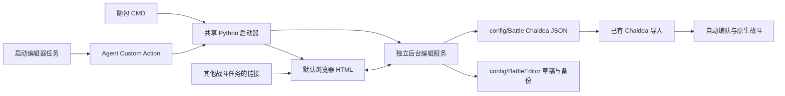

# MaaFGO HTML 编队与战斗逻辑工具制作方案

日期：2026-10-23。状态：首版已实现；自动化与本地浏览器验收记录见 [实现与验收记录](HTML编队与战斗逻辑工具实现与验收记录.md)。真实 MXU 界面与游戏实战验证单独列明。

本工具随 MaaFGO 打包，以本地 HTML 页面提供编队和战斗回合编辑。玩家双击随包 CMD 或运行专用任务启动服务并打开页面，之后可从其他战斗任务描述中的链接重新打开。两个入口调用同一份 Python 启动逻辑。正式保存的数据采用 Chaldea 解码后的 `BattleShareData` JSON，写入现有 `config/Battle`，继续交给当前自动编队和原生自动战斗读取。

## 1. 已确定的范围

| 项目 | 第一版约定 |
| --- | --- |
| 客户端 | 仅 MXU；暂不适配 Android |
| 启动入口 | 随包“打开编队编辑器.cmd”及独立的“打开编队与战斗编辑器”任务 |
| 再次打开 | 服务运行期间，点击其他战斗 task / 战斗选项描述里的普通 HTTP 链接 |
| 服务生命周期 | 启动任务结束或浏览器关闭后继续运行；重复启动任务复用服务 |
| 战斗能力 | 完整编辑当前工程支持的固定回合技能、御主技能、换人、敌方目标、宝具与面卡顺序 |
| 数据输出 | 原始 Chaldea `BattleShareData` 结构，保存到本次软件实例的 `config/Battle` |
| 使用方式 | 保存后复制文件名，填入已有“Chaldea 队伍导入”；保留手动选文件方式 |
| 联网要求 | 日常编辑、图片展示和保存可离线；导入线上分享时才使用现有联网能力 |

第一版不加入 HP / NP 条件分支、按波次等待执行、BBC 扩展动作、伤害模拟和自由编程脚本。特殊技能内部选项沿用工程当前固定处理，不提供尚未被执行器消费的选择器。

本方案作为首版范围与验收依据保留。CMD、Maa task、独立服务、离线图鉴、正式界面及保存链路已经接入；玩家操作见 [使用说明](HTML编队与战斗逻辑工具使用说明.md)，代码分工、素材重建与映射契约见 [维护说明](HTML编队与战斗编辑器维护说明.md)。六人竖卡改版沿用原有双入口与文件格式。

## 2. 已核实的基础与约束

### 2.1 文件与格式

- `agent/chaldea/__init__.py:25` 定义现有目录 `config/Battle`；`:137` 起的本地加载支持文件名、相对路径和绝对路径。本工具无需创建第二套战斗方案读取入口。
- 该目录存的是解码后的 Chaldea 分享对象；`BBchannel/settings` 下的 BBC 配置是另一种格式，不能作为编辑器的数据底座。
- 现有加载器只检查部分结构。文件能被加载，不等于全部动作可以执行，也不等于已通过 Chaldea 官方模型解析。
- `agent/main.py:47` 会把工作目录切到 `agent` 的父目录。开发目录中 `interface.json` 位于 `assets`，因此保存根目录不能直接写成 `interface.json` 所在目录。

### 2.2 启动与链接

- 当前 Maa Agent 在 MXU 启动任务时创建，资源和控制器连接属于现有任务启动流程。
- 第一版沿用独立 task 启动，取消“随 MXU 自动启动服务”的前置要求，也不新增 MXU 启动钩子。
- 任务描述已经能展示普通 HTTP 链接。独立 HTML 无法自行启动本地 Python，因此首次使用需要先运行启动任务。
- 编辑服务必须是独立后台进程；不能只在 Custom Action 中起一个随 Agent 结束而消失的线程。
- 启动 task 本身只进行本地服务管理，不发送点击、滑动或战斗指令。现有 MXU 将普通 Custom task 视为视觉任务，首版沿用现有设备连接流程；task 的 `controller/resource` 是字符串数组，不能填写 `false` 来跳过连接。
- 若后续要求无设备启动，只需另行将该 task 纳入 MXU 的非视觉任务判定，走现有 Dummy Controller 路径；这不涉及开机启动钩子。单独使用 `pretask` 会在执行后出现“无可运行任务”，不作为首版替代方案。

### 2.3 当前执行能力

- 每个 `type: "attack"` 结束一个整场战斗回合。UI 使用“第 N 回合”，不把“第几面”作为执行触发条件。
- 动作中的 `svt` 是动作发生时的当前前排位置。换人后，前排 1 号的后续技能属于换入者。
- 宝具与面卡可以混排；缺少指定面卡或宝具不可用时，当前执行器会以默认面卡策略补齐。
- 实施前转换器只识别字符串色卡，现已补齐 Chaldea 正式整数与数字字符串兼容，并保留历史字符串支持，见第 6 节。
- 实战仍受技能冷却、识别状态和执行确认限制，可能跳过技能或停止。离线检查核对计划结构与支持范围，阵容预览不保证实战必然沿计划完成。

## 3. 玩家操作流程

### 3.1 新建并调用

1. 在 MXU 运行“打开编队与战斗编辑器”。
2. 任务启动或复用服务，确认服务就绪，再打开默认浏览器；随后任务正常结束。
3. 在页面新建方案，设置六个从者槽位、助战、礼装和御主礼装。
4. 添加回合，按实际执行顺序配置技能、换人和三张出卡意图。
5. 在“检查与保存”查看可读摘要和问题，保存到战斗方案目录。
6. 页面显示真实文件名及保存路径，提供“复制文件名”。在原有 Chaldea 导入框填写该文件名即可调用。

也可直接双击软件目录中的“打开编队编辑器.cmd”，从同一启动逻辑进入编辑器。此入口不经过 MXU 的任务设备连接流程。

第一版不自动修改 MXU 当前 task 的选项值。“保存并应用到当前任务”需要额外的客户端配置回填契约，留作后续完善项。

### 3.2 继续编辑已有方案

页面方案库列出 `config/Battle` 下的有效队伍，显示队名、前排头像、回合数、文件名和修改时间。支持搜索、新建、打开、复制和另存为。损坏文件显示独立错误记录，不妨碍浏览其他方案。

导入支持本地 JSON 上传、已有 Battle 文件和现有 Chaldea 分享链接 / ID 解码。上传文件先进入编辑草稿，不立即覆盖原文件。导入后先给出当前执行能力检查，再进入编辑。

### 3.3 关闭网页与再次打开

关闭浏览器标签页不会停止服务。其他战斗任务中的“打开编队与战斗编辑器”链接指向同一个本地地址，点击后可恢复方案库和已落盘草稿。

服务尚未启动或已经退出时，链接说明明确提示“先运行打开编队与战斗编辑器任务”。重新运行该任务即可恢复服务与页面。首版不要求普通网页链接具有启动本地进程的能力。

## 4. 页面与视觉设计

### 4.1 参考取舍

借鉴 [mash-app](https://github.com/ZaiZheTingDun/mash-app) 和 [演示视频](https://www.bilibili.com/video/BV1Bfpk6GEG4/) 的六槽编队、助战强调、人物搜索、回合导航及顺序动作编辑。视频中 00:24 展示编队，02:44 展示技能流程，03:12 展示出卡，05:16 展示换人。

视觉在首版基础上改为 FGO 蓝白金配色，保留深蓝模式、细边框和少量菱形节点；正文以中文为主。编队参考原生六人竖卡，回合操作参考原生战斗技能区；色卡同时用颜色、中文和 B / A / Q 字母表达。

使用项目已有角色、礼装资源。Mash 的原创代码声明 MIT，游戏图像另有第三方权利说明；若后续复用实质源码，保留对应版权与许可。其自身战斗 JSON 不作为本工具格式。

### 4.2 信息架构

顶部常驻方案名、当前文件、未保存状态、草稿状态，以及“方案库 / 导入 / 撤销 / 重做 / 保存”。主导航分为“编队”“回合逻辑”“检查与保存”。

```text
方案库 | 方案名                     草稿已保存 / 正式文件已保存 | 撤销 重做 保存
──────────────────────────────────────────────────────────────────────
                    编队       回合逻辑       检查与保存
──────────────────────────────────────────────────────────────────────
编队页：     前排 1 2 3  |  候补 4 5 6（横向六张竖卡）
             头像 → 成员信息 → 礼装；选中槽位的详情在下方
             御主礼装 / 助战标识 / 普通与冠位礼装概况

回合页：     左侧回合列表       三名当下前排的头像 + 方形技能 + 宝具卡
             第 1 回合          御主服 / 三个御主技能 / 换人弹窗
             第 2 回合          下方有序技能列表 + 独立出卡组 + 动作详情

检查页：     人类可读打法摘要   错误与警告定位       保存与导出
```

### 4.3 编队页

- 六槽固定编号，横向排列六张竖卡，前排与候补中间分隔。每卡上部为竖幅从者头像，中部为成员信息，下部为概念礼装；助战标记在右上角。空槽保留位置，提供“选择从者”。
- 从者选择器支持中文 / 日文名称、已有别名、内部 ID、图鉴编号；职阶图标和星级按钮直接平铺，有个人库存时可切换“仅持有”。
- 从者星级行右侧提供“排序依据＋升序/降序”控件，首次默认按内部ID数值升序，可选图鉴编号、星级；选项使用独立定义表便于扩展，未知的个人等级/羁绊等不作为伪造排序依据。先筛选、再排序、最后分页，不改变图鉴原数组；主值缺失始终置末，相同主值按内部ID升序稳定排列，星级0有效，图鉴编号0视为未登记。排序/方向变更回到第一页。
- 当前浏览器记忆从者选择器的职阶、星级和排序设置，选入、关闭重开、刷新或重新打开页面后恢复；“全部”和清除筛选会同步更新记忆。只保存界面偏好，不写入Battle/草稿/导出JSON，不影响概念礼装和御主服选择器；搜索词、仅持有、高级筛选仍遵循原来的临时状态。无效或过时的保存值安全回退，浏览器禁止存储时仍可正常选择。
- 概念礼装使用独立版本化偏好记忆星级、常用礼装和仅持有，初始为全部星级、常用勾选、仅持有关闭；搜索临时，御主服不读写此偏好。库存未加载或不可用时暂不启用持有筛选，不因恢复已勾选偏好而错误筛空；保留该偏好供可靠库存就绪后恢复。清除筛选更新相应记忆，不写入方案及草稿。
- 从者与概念礼装条目的星级移到各自图片下方，使用金黄色并居中排布；图片与星级组成独立视觉列，保留现有图片比例与信息列文字大小。0星与星级未知有明确标签，御主礼装不额外显示星级。
- 编队底部将羁绊按钮左移，右端新增可点击的游戏风格TOTAL COST条，按当前六槽配置实时计费并可编辑上限（默认117，1–300整数、浏览器记忆、羁绊弹窗同步）。目录仅公开既有bond_completion_costs索引的有效数值，不按稀有度猜测；别名归一，助战整槽免费，普通从者仅计有效主礼装，兼容旧ceId且显式0不回退。未配置项不推测游戏装备，自有冠位或缺资料明确显示未知，避免错误超限判断；配置和未知字段保持保真。
- “检查与保存”把实时COST超限作为warning加入问题列表及数量，显示当前值、上限和差额，点击打开COST详情／上限设置；已知小计超限但有未知项时明确“至少超出”。不改后端结构报告的valid、不计入阻断问题，不把浏览器上限写入方案；保存、重新检查、撤销及修改上限后通过派生列表保持提醒一致。
- 多回合方案（至少两个实际回合）检查已有前三回合，无宝具安排时逐回合增加early_turn_no_np warning并定位对应攻击动作；末尾仅技能的隐式默认选卡回合定位首个技能。普通卡与isAuto占位不算宝具，后置宝具照常识别；不虚构未配置回合、不检查第4回合起，不改变valid或保存门槛。
- 导入弹窗提供“从 config/Battle 选择”，直接显示当前安装实例的真实目录、可搜索文件列表和刷新，损坏文件禁用导入；读取最新文件后进入独立草稿，保存时另建文件。浏览器系统文件选择仍保留用于目录外 JSON；不依赖它自动定位目录，不新增任意文件路径读取能力。
- 从者选择器提供默认收起的“高级筛选 [展开]”，展开后可筛选阵营（秩序/中立/混沌）、善恶属性（善/中庸/恶/夏/狂）、性别特性、天地人星兽、羁绊特性（拥有灵衣之人、兽科、活在当下的人类、FSN、星之力）以及宝具类型（单体输出/群体输出/辅助）与 Buster/Arts/Quick。与基础搜索、职阶、星级、持有条件取交集；所选羁绊特性须同时满足。收起不清空，收起标题显示已启用数量；提供单独清除高级条件及全量清除，改条件后回到第一页。
- 高级资料以用户 `servant_list.csv` 为依据；当前工程 `agent/custom/servant_list.json` 中对应 472 名可选从者的 `bond`、`np_type/np_card/np_variants` 已与 CSV 深比较一致，直接随现有离线目录提供，不修改运行时编队目录或新增 NPC。`bond` 与 `npFilter` 只用于图鉴，不写入战斗 JSON。缺资料不伪造，未筛选相应字段时仍可选择。
- 羁绊默认检索 CSV 基础资料，可选“包含灵基 / 灵衣条件”；按独立形态匹配，不能把不同灵基的特性合并成同时成立。只由条件形态命中的结果标“部分灵基 / 灵衣”。`lawful_neutral` 是秩序·中庸；星之力、星属性、兽科、兽职阶及原始条件标签 `beast` 不能混同。灵衣资料没有具体灵衣 ID，不自动选择灵衣。性别为“不明”的记录可能仍含男性/女性特性，不能按互斥推断。
- 宝具类型与色卡必须由同一条 CSV `np_variants` 满足，不能对分隔汇总字段做笛卡尔组合；筛选结果只是可选从者候选，不保证任意灵基条件和宝具模式同时可用，界面提示核对实际形态。筛选不会改动成员的 `ascension/tdId` 或其他导入字段。
- 卡片显示头像、姓名、星级、自有 / 助战、等级与技能 / 宝具概况。主动技能及追加技能等级设置显示对应技能图标，按选定技能变体 ID 查找，缺失时明确回退。相同角色的自有与助战始终保留独立槽位标识。
- 下方槽位详情编辑等级、主动技能、追加技能、宝具等级、灵基等已有字段；区分“记录属性”“助战筛选”和“自动编队实际消费的字段”。自有从者不会因为填写等级而在游戏内升级。
- 卡片下方礼装可直接点击打开选择器；普通从者一个礼装按钮，冠位从者三个按钮自适应卡宽。礼装预览按原图比例完整显示，不裁切。支持满破和等级，并标明当前自动编队对冠位三礼装的处理边界。
- 已存礼装设置的右上角提供独立叉号，点击只清除该槽礼装要求，显示“不要求礼装”，不表示强制卸下游戏内礼装。删除整个对应 `equip1/2/3` 对象；清除第一礼装同时移除旧 `ceId/ceLimitBreak/ceLv`，避免旧格式回退恢复要求。冠位三槽互不影响，清除后不新增 `id:0`、`null` 或 `id:null` 占位。已有空 ID 的导入设置也可用叉号清理。
- 礼装选择器默认勾选“常用礼装”，范围来自本安装实例的 `resource/base/image/lizhuang`（开发目录前缀为 `assets`）中实际命名的礼装，排除空选项；与名称、星级和持有筛选取交集，取消后查看全部礼装。
- 从者、概念礼装、御主礼装选择器固定使用当前视口允许的最大弹窗尺寸，不随结果数量、分页或高级筛选展开/收起改变外框大小。保留现有最大宽度，桌面高度沿用 92% 视口上限、窄屏 95%，并扣除遮罩安全边距；标题、关闭按钮及底部分页位置稳定。内容在中间区域滚动，少量或零结果保留空白，不拉伸单张卡片；滚动条出现与否不改变内容列宽。
- 概念礼装选择列表在窗口宽度大于900px时每行三张，601–900px每行两张，600px及以下每行一张。继续使用原比例完整礼装图、现有较大文字与两行名称，编号可换行，不横向溢出；筛选、分页、选择行为及固定最大弹窗尺寸不变。
- 御主礼装用衣服轮廓作为标题图标，显示名称、图像、等级与换人能力提示。编队页采用紧凑卡片（桌面约 720px 上限，窄窗口自适应），不随六人编队板拉满；“更换”按钮置于卡片内部，等级输入保持小尺寸。页面明确显示游戏内需自行使用对应御主礼装。
- 新建方案显式使用“决战用迦勒底制服”（`mysticCodeId:210`）、`level:10`，与 [Chaldea 新建战斗设置](https://github.com/chaldea-center/chaldea/blob/e656fa4b3e23228805efdec851358e0ab319aeeb/lib/app/battle/models/user.dart#L485) 一致。此默认值仅用于新建方案；导入、打开、复制与草稿恢复保留原有御主服、空值或缺字段，不因打开页面自动补值。
- 新队伍第1位默认好友助战：用独立会话标记及草稿editorState记录，不给空槽写伪从者或方案字段。首次进入及显式新建启用；通用打开／导入／复制关闭，草稿仅恢复严格true且无正式来源的标记。第1位为空且无既有好友/NPC/fixed时选入才设friend，已有成员更换保留类型；成功正式保存或应用原始JSON后结束新队伍默认。空槽只显示预设标记，COST仍0，羁绊预留优先实际助战再考虑该空首槽。
- 好友助战允许仅礼装配置：用真实需求对象supportType:friend及equip1等记录，svtId省略（兼容null/0），与null空槽区分。默认助战空槽直接选礼装可创建该对象，任意空槽可显式设为仅礼装助战；已选好友可显式清除从者要求并保留礼装、grand及未知字段。身份判断统一使用正安全整数svtId；未知助战有真实位置但无已知技能、宝具、牌组或CD，不提供这些动作及手动就绪。站位技能目标与换人可指向未知助战，后续能力按换人后的阵容判定。校验、Chaldea助战转换、自动编队、羁绊补齐联动现有class_name:any跳过从者匹配能力；NPC/fixed不扩大为随机好友。
- 支持清空、拖动交换与移动槽位。拖动交换整个成员对象，保留脚本槽位指向，提示已有动作影响并支持撤销；按钮交换仍提供影响预览及“按角色重映射”。重映射只处理已完整理解的动作；存在换人或未知动作时禁用不可靠重映射。
- 拖动达到 6px 后整张从者卡片浮起并跟随鼠标，保留按下时的抓取偏移和卡片尺寸；原槽位留占位、有效目标高亮。浮卡不参与命中检测、焦点或读屏，不能触发重复交换。同槽/编队外放下以及 Escape、失焦、页面隐藏、捕获丢失取消，清理浮卡；成功落位只交换一次整个成员，支持撤销，礼装点击不误触拖动。
- 空槽首次选从者时按当前助战 task 初始化 `skillLvs:[10,10,10]`、`appendLvs:[0,0,0,0,0]`（来源 `assets/options/support/共享助战.json`）；追加 0 表示不要求，不代表技能实际解锁。好友用作筛选，自有/NPC不能据此宣称实际养成。已有成员、导入、打开、复制、草稿恢复和切换成员类型不自动补值；更换已有从者保留原技能设置。属性区提供“补齐技能默认值”，仅补缺失/空项，保留显式 0 与所有已有等级/额外字段，一次操作可撤销。

### 4.4 回合逻辑页

宝具按钮使用现有 `agent/battle/card_composer.py` 本地合成器生成完整透明 PNG，包含原生从者指令卡立绘、宝具底框、色卡图标及准确宝具文字；替换原先头像/裸框/HTML文字叠层，按整图比例完整显示。保留宝具点击入列、重复禁用、选中标记和可访问名称，原始战斗动作不变。

宝具合成采用维护期生成的离线绑定资料：精确匹配所选 `tdId` 的 Atlas 图标与 `npSvts.imageIndex` 行号（两行图使用 `% 2`），按已登记头像及 Chaldea `limitCount→dispLimitCount` 映射选择立绘。未指定灵基使用明确的默认原生卡面，仅作预览；无法识别的宝具/变身/灵衣不猜图。预览可选日服/国服文字，默认日服，仅影响界面，不回写方案或替代 MXU 区服设置；缺国服文字不借用日服。

服务只从当前安装目录的已登记本地素材合成，固定 1280×720 合成配置并使用有限缓存；通过会话保护的 PNG 接口提供给页面，浏览器负责释放预览资源。无网络、无运行时落盘、无任意路径/分辨率参数；合成失败降级为带名称的文字宝具按钮，仍可编排，不再显示空底框伪装整卡。

下方“宝具与色卡”的三个出卡位也用完整宝具/指令卡图显示，普通 B/A/Q 通过同一本地合成器的 face 模式生成；按该攻击发生时的阵容显示准确从者，保留序号和可读说明。支持拿起整卡跟随鼠标，在同一攻击组的卡片或默认补齐空位放下调整顺序，支持取消、撤销及键盘编辑路径。单张宝具可放到第2或第3位，前置空位明确使用默认普通选卡。通过 Maa 扩展对象 `{"isAuto":true}` 记录需要保留的中间空位，转换器将其保留为逐位置的默认面卡意图，由运行时按现有策略补齐；不绑定角色、卡色或屏幕位置，不使用会被转换器跳过的null。普通卡与宝具仍保留原完整对象，未知/超出三项的原记录保留。末尾纯默认占位可省略，追加卡片优先填补默认空位；摘要、校验与高级出卡编辑遵守同一语义。

已安排宝具和普通指令卡右上角提供独立叉号。删除指定 `attacks` 整对象，后续项按原顺序左移，末尾恢复默认选卡补齐；不删除攻击动作、敌方目标或同回合技能，导入的第四项及后续数据保留。删除宝具后，上方对应宝具按钮按当前计划重新恢复可安排状态。礼装与出卡叉号均支持键盘、撤销/重做和草稿自动保存，点击不打开选择器、不触发拖动或换位。

从者选择列表头像使用更充分的单格空间：桌面72×84px，中等/窄窗口分别64×74px和52×62px；保持三列/两列布局及名称、职阶、宝具属性信息可读。此尺寸仅作用于从者选择器。 从者和概念礼装一览中的名称、星级/类型、宝具摘要及编号一并放大：桌面16/13/12px，中等窗口15/12/11px，窄窗口14/12/11px；名称可显示两行，卡片高度自适应，图片尺寸与比例不变。

编队六张竖卡的主图横向填满，人物大小通过同灵基完整CharaGraph卡面构图控制，避免NarrowFigure窄条撑宽造成的过大近景。卡框继续采用512:724比例，完整显示且不裁左右，不变形、无大块侧边留白。完整卡面从原图512×724准确裁区先读取不透明RGB，保留近黑透明像素下面的真实颜色，再LANCZOS将宽高各缩至70%（取整358×507），编码为WebP Q90/method6，避免原素材Alpha孔洞漏出浅底；此流程仅用于完整矩形展示卡面。编辑器中的卡框与显示尺寸保持原样，自适应填充缩小后的资源，不缩小页面人物。技能/礼装、职阶/助战/冠位标记、点击和浮动拖动交互沿用原规则，其他UI图和识别模板继续使用原PNG且不缩放；此方案取代窄条整图contain及完整卡面256色PNG。

技能冷却覆盖文字需在灰化图标上清晰可读：从者/御主默认20/15px加粗白字并加强暗色描影，中等窗口18/14px、窄窗口16/13px；范围值或未知状态可换行，保留原有CD推算和右键就绪行为。

同一回合可把多个技能临时置为就绪；成功使用其中一项后仅消费该项，其他已标记技能继续可用，加入宝具不清除这些标记。取消目标选择或提交失败时保持原状态。切回合、换人、撤销/重做、切换方案及外部数据编辑清除许可，避免带到错误成员或历史位置。临时标记不写进战斗JSON，不改变游戏内CD。

本节于 2026-10-23 按战斗界面交互需求先修订、后实施，已完成本地浏览器与自动化验收；完成项、基础 CD 边界和未执行实战范围见验收记录。

**战斗技能区。** 左侧保留全局回合导航及新增、复制、移动、删除；中央上方展示三名当前前排，优先使用已有 `ServantStatus` 透明头像。每名从者下方横排三个方形主动技能图标，再下方显示一张由宝具颜色与名称组成的小型宝具卡。右侧显示当前御主服、选择服装按钮及三个御主技能。缺头像回退已有头像，缺技能/宝具资料显示明确名称/编号，不借用其他人物。

技能区的阵容与 CD 固定表示“本回合已排列技能之后、攻击之前”的状态；选中历史步骤只改变下方属性详情，不改变新动作的插入位置。换人后即时显示换入者及其技能，新增技能仍指向当前站位。相同从者的自有和好友是独立编队实例，不共用 CD。

**点击技能与目标。** 左键点击就绪技能，按点击顺序追加到该回合攻击动作之前。可靠元数据表明需选我方单体时，先弹出三人头像选择，点击合法头像立即追加并关闭，不再二次确认；从者与御主技能一致。`ptOneOther` 排除施法者，空槽不可选。自用、全体或自动作用技能直接追加。资料未知/特殊分支提供点击头像或“不指定我方目标”的直接加入入口，并提示沿用工程现有特殊处理，不据名称猜测完整效果；混合敌方目标放在头像前调整，选择头像时一并提交。取消弹窗不写动作、不消耗临时就绪许可。换人需要选择双方，保留确认按钮。

有单体敌方作用的技能默认选“敌方 1（左侧）”，可在下方步骤属性中修改为左/中/右。界面位置编号按玩家从左到右，Chaldea 原始索引反向（左 `2`、中 `1`、右 `0`），导入值不重写。当前工程原先忽略技能的 `options.enemyTarget`；本轮补齐转换器和执行器的逐技能切敌，将此目标在该技能前实际选择，攻击组仍可另设目标。范围限现有普通三个敌人，不新增特殊部位/多行敌人。

**冷却与重复施放。** 施放后图标置灰，显示基础 CD；再次左键不重复追加。按准确技能变体、`coolDown[等级-1]` 取值；等级未填或为 0 时显示真实 CD 范围，不暗设满级；缺资料显示“CD 未知”。在玩家回合结束时，仅当时在场的三名从者与御主技能递减一次，候补暂停。例如 T1 使用 CD6，T2 为5、T7就绪；T1 被换到候补的从者不参与该回合末递减。

右键菜单提供“置为就绪”，同时提供可点击/键盘可达的同等入口。此操作只解除当前编辑位置的按钮限制，不删已有步骤、不增加正式 JSON 命令；下一次左键可继续追加同一技能，因此可同回合连续使用多次。临时许可在使用或计划/回合变化后清理，取消选目标时保留。导入的重复技能照序保留并回放；御主重复施法的执行校验同步放开结构性去重，仍保留运行时可用性检查。

本轮为“基础 CD 预览”，不模拟追加技能5、技能/宝具减 CD、技能封印、变身、死亡退场等完整战斗效果。以上情况通过手动就绪表达后续计划，页面显示简短说明；不以预览 CD 阻断既有 JSON 导入或正式保存，也不声称右键能在游戏中重置 CD。回合、动作、技能等级、变体或换人调整后从动作序列重算，避免只修改图标而保留过时 CD。

**下方列表与实时保存。** 按点击顺序展示编号、施法者、技能图标/名称、我方及敌方目标；每步有详情和 X 删除，技能列表支持拖动与上下移动按钮排序，删除和重排可撤销。换人步骤及其 `delegate.replaceMemberIndexes` 始终一同移动/复制/删除，阵容和 CD 实时重算。动作改动立即反映到界面，沿用约一秒防抖的磁盘草稿自动保存；正式 Battle 文件仍通过“保存方案”提交，避免混淆。

**检查页图像摘要。** 每回合保留完整动作顺序，技能用小尺寸施术者头像、技能图标、名称及目标头像串联，御主以所穿御主礼装图标表示；换人显示双方头像与方向。攻击显示每张宝具／色卡的缩略图、卡色及从者头像，空攻击明确由默认策略补齐。每个Entry使用全局动作索引解析执行前阵容，尊重显式技能／宝具变体和实际cardType；缺资料、无效位置及未知动作保留准确文字回退，不借用另一成员或默认变体。摘要仅读取数据，不写回计划；紧凑图标与可换行文本保证长名称可读。

**御主技能与换人。** 回合页可直接选择御主服和等级，使用现有 28 套图像与技能资料。换人服技能3打开独立弹窗，从当时前排与候补各选一名后确认；双方必须非空且位置合法。确认后一次性写入御主技能与配对索引，取消不加步骤。换人后的技能区、目标弹窗与下方后续步骤均重新解析。更换御主服需提示检查已有御主/换人动作，未知字段及原 delegate 不能静默丢弃。

**宝具与色卡。** 宝具按钮将标准 NP 意图追加到本回合唯一 `attack.attacks`，不是立刻释放，也不插入技能步骤。每回合最多三个出卡意图，同一当前前排宝具最多一次；NP 无技能 CD、不模拟 NP 条或保证可用。使用 `tdId` 的准确宝具变体确定名称与颜色；动态变色仍以实际游戏为准。

技能与换人总在攻击之前，不能拖到宝具/攻击之后；NP、Buster、Arts、Quick 在独立出卡组内混排与排序。少于三项时显示“其余由当前默认选卡策略补齐”。保留高级技能改色/真实牌组索引编辑与原始字段查看，不增加当前执行器未实现的备用队列或任意选卡策略。多回合切换自动重算 CD，新增回合定位到新回合，长列表在编辑区滚动查看。

基础 CD 依据固定版本 [Chaldea 回合结束](https://github.com/chaldea-center/chaldea/blob/e656fa4b3e23228805efdec851358e0ab319aeeb/lib/app/battle/models/battle.dart#L1335)、[技能 CD](https://github.com/chaldea-center/chaldea/blob/e656fa4b3e23228805efdec851358e0ab319aeeb/lib/app/battle/models/skill.dart#L78)；不等同运行完整 Chaldea 战斗模拟。

### 4.5 交互与可读性

- 桌面验收覆盖 1280×720、1366×768、1920×1080，并检查 Windows 125% / 150% 缩放与浏览器 200% 缩放。
- 窄窗口保留横向六张竖卡，通过编队区域内部横向滚动查看；详情下置，主要操作保持可达。
- 默认以 FGO 蓝、白、金配色为主，复用本地游戏 UI 素材；支持深色模式并保持文字对比度。新增资产通过本地脚本建立 ID 与图片映射，发布产物无需依赖原始 FGO 整包。
- 正文原则上不小于 14px；图标按钮有中文名称，键盘焦点清晰；筛选器、对话框和排序可用键盘完成。
- 每个问题可点击定位到对应槽位、回合或动作。保存失败保留编辑状态，错误提示指出原因与可执行的下一步。
- “草稿已保存”和“正式文件已保存”分别展示，避免玩家误认为草稿已经可供战斗调用。

## 5. 第一版功能清单

| 功能 | 编辑内容 | 执行或保存边界 |
| --- | --- | --- |
| 六人编队 | 自有、助战、空位，前排与候补 | 固定保留 3+3 数组，空位写 `null` |
| 助战 | 类型、技能 / 宝具 / 等级要求、礼装要求 | 对齐现有筛选逻辑；未填要求保持“不限制” |
| 从者与礼装属性 | 已有 Chaldea 属性、普通与冠位礼装 | 保存不等于游戏内自动设置所有属性 |
| 从者技能 | 当前前排 1–3、技能 1–3、我方目标 | 依动作原顺序执行 |
| 御主技能 | 技能 1–3、我方目标 | 依赖游戏内实际御主礼装一致 |
| 换人 | 当前前排与当前候补各选一人 | 仅现有换人礼装；换后更新阵容预览 |
| 敌方目标 | 每技能及攻击组的左 / 中 / 右 | 本轮补齐技能前切敌；仅普通三敌人范围 |
| 宝具 | 当前前排选择、混合出卡顺序 | 不可用时按当前执行器行为补面卡 |
| 面卡 | 当前前排角色 + B / A / Q | 同人同色无法指定实时屏幕上的唯一一张 |
| 空攻击 | 明确“不指定宝具，普通选卡补齐” | 仍生成一个回合边界 |
| 计划结束 | 摘要显示当前默认后续行为 | 超出脚本后恢复原生默认策略 |
| 特殊技能内部选项 | 展示当前工程固定行为 | 导入的不同子选项保留并提示执行不一致 |
| 草稿与历史 | 自动草稿、撤销重做、另存、覆盖备份 | 草稿与历史文件不进入正式 Battle 目录 |
| JSON 检视 | 查看原数据、字段路径与保留项 | 可视化不支持的字段保持原样 |

没有可靠技能元数据时仍可按槽位与技能编号编辑。不能凭空猜测技能目标、CD、玩家实际 NP 或必然清波结果；这些条件只做有依据的提示，不输出“实战一定成功”的校验结果。

## 6. Chaldea 数据契约

### 6.1 输出结构

以完整原始 JSON 树为主数据，对已编辑字段按路径更新；前端内部的成员标识、撤销记录与页面状态存入独立编辑草稿。

| 页面内容 | 对应字段与规则 |
| --- | --- |
| 队名 | `team.name` |
| 六槽 | `team.onFieldSvts[0..2]`、`team.backupSvts[0..2]` |
| 从者 | `svtId`、`lv`、`skillLvs`、`appendLvs`、`tdLv` 等原有字段 |
| 灵基与变体 | `limitCount`、`skillIds`、`tdId`、`transformVal`，保留导入值 |
| 概念礼装 | `equip1` / `equip2` / `equip3` 的 `id`、`limitBreak`、`lv` |
| 助战 | 新建使用官方 `none/friend/npc`；历史 `fixed` 输入保留并显示标准兼容提示 |
| 御主礼装 | `team.mysticCode.mysticCodeId`、`level` |
| 从者技能 | `{type:"skill", svt:0..2, skill:0..2}`，有我方目标时添加 `options.playerTarget:0..2` |
| 御主技能 | 技能动作中 `svt` 省略或为 `null` |
| 换人 | `delegate.replaceMemberIndexes`，新建使用 `[前排0..2, 候补0..2]` |
| 攻击与回合 | `{type:"attack", attacks:[…], options:{enemyTarget:0..2}}` |
| 宝具与面卡 | 攻击项的 `svt`、`isTD`、`card`、`cardType` 等官方字段 |
| 关卡与额外参数 | `quest`、顶层 `options`、`delegate`、`minBuild/appBuild` 等完整保留 |

UI 编号使用 1-based，序列化统一转换为 Chaldea 的 0-based。敌方索引与游戏画面左右相反，由适配层统一转换，不把原始数字直接作为玩家标签。

`card` 表示从者自己的牌组索引，不是屏幕第几张卡。普通五张牌组的有效面卡索引为 `0..4`，新建时需要补充完整牌组元数据；不能统一填写占位数字，`cardType` 也不能代替合法索引。标准宝具记录使用 `isTD: true`、`card: -1`。UI 仍按当前引擎能够执行的“角色 + 颜色”表达意图，并说明同人同色的执行精度。

### 6.2 色卡兼容修复

已核对 Chaldea 官方版本 `e656fa4b3e23228805efdec851358e0ab319aeeb`：正式输出 `Arts=1`、`Buster=2`、`Quick=3`，读取也接受数字字符串及历史色名字符串。

当前 `agent/battle/data/chaldea_converter.py:208` 仅匹配字符串色名，现有真实缓存已经存在数字面卡。发布前必须补齐三类输入，覆盖混合出卡、未知色种和非法值；新建正式数据使用官方整数。

普通保存不无故改写未编辑节点的旧表示。提供标准化导出时，列出被转换的字段，并且不把特殊色种误映射成 B / A / Q。

### 6.3 保真与能力检查

1. 无改动导入再另存，要求 JSON 值深比较一致；格式缩进和对象键顺序不属于承诺。若提供原文下载，则保留原始文本。
2. 修改一个已知字段，只改变对应路径。深层未知字段、数组顺序、缺失与 `null`、旧礼装字段和追加技能数组长度均须保留。
3. 未知动作在时间线中显示保留占位及原始内容，不能静默删除。允许下载保真副本；包含未支持动作的方案不能被标为“当前 MaaFGO 可执行”。
4. 编辑器的正式“保存到战斗方案目录”要求可执行检查通过；未完成或存在阻断项的内容可保存草稿。保真副本导出与正式可执行保存明确区分。
5. 不经 BBC 配置或 `TurnPlan` 反向生成文件；它们会丢失完整 Chaldea 字段。
6. 缺失助战筛选值保持“不限制”，不默认补满宝具和技能；新建数值需要在页面上明确展示。
7. 六槽跨前排、候补检查重复自有从者：按规范从者 ID 及已登记形态别名判断，灵基、灵衣和冠位设置不使同一身份变为不同从者；不同职阶/版本的独立从者不按显示姓名合并。同一身份最多一位自有成员，好友/NPC及历史 fixed 助战可与其共存；即使另有助战，两位自有同一从者仍为阻断问题，提示重复位置并可定位修改。空位不参与，非法 ID 保留原有结构错误；无目录资料时按有效正整数原始 ID 判断。
8. 队伍没有任何 friend / npc / fixed 助战标记时，在检查页显示非阻断提醒，说明特殊关卡或无助战方案可忽略，不自动指定助战，不阻止正式保存。助战在前排或候补都有效，历史 fixed 继续保留兼容提示，多助战仍沿用现有阻断检查。检查不修改原方案；编队级提示的“定位”回到编队页。

实施前列出新建默认值表，逐项定义 `tdLv/lv/skillLvs/mysticCode.level`、目标未指定和空攻击。表单区分“未指定”与显式数值；导入缺省不得被 UI 初始值回写，不沿用 BBC 的默认宝具 / 御主等级。

### 6.4 当前能力限制的呈现

冠位三礼装可保存，但当前自动编队对冠位从者跳过礼装修改；冠位助战的可见礼装与 `equip1/equip3` 对应，`equip2` 的处理依据现有羁绊效果逻辑。相关字段需有准确说明。

`delegate.skillActSelectSelections`、`tdTypeChanges` 等尚未完整传入当前执行器。涉及这些选项的导入数据应保留，并列出与当前固定行为不一致的位置；不能显示为可自由配置且已生效。

Chaldea 模拟参数不是 MaaFGO 的选卡策略参数。第一版不把顶层 `options` 内的模拟设置伪装成运行开关。

## 7. 本地服务与任务接入

### 7.1 结构



CMD 使用自身 `%~dp0` 定位内嵌 Python 和启动器，负责双击入口；Agent Custom Action 直接调用共享启动模块，不通过 `cmd /c` 转接。共享模块承担服务身份检查、启动 / 复用、等待就绪和打开浏览器，并返回结构化结果与失败原因。

服务入口位于 Agent 目录，作为独立 Python 进程运行；不通过导入 `agent/main.py` 启动，避免重复注册 Maa / BBC 模块。Custom Action 可使用 `sys.executable` 沿用当前 Agent 的 Python 环境，服务工作目录仍由启动器明确指定。

MaaFramework 还有内置 `Command` 动作，支持 `exec/args/detach`，但已核查的实现等待进程后没有检查其退出码，因此不将其作为首版唯一的启动成功判定。`detach:true` 也不能证明服务就绪。首版优先用工程已有的 Custom Action，把端口冲突、启动超时等真实失败回报 MXU。`Shell` 动作运行在 ADB 设备端，不用于启动电脑上的服务。

### 7.2 固定链接与端口

第一版已采用固定本机端口 `http://127.0.0.1:18765/`。启动器验证服务身份和安装根目录后复用，不会改用另一端口。

task 和共用战斗选项描述插入普通 Markdown 链接：

```markdown
[打开编队与战斗编辑器](http://127.0.0.1:18765/)

首次使用请先运行“打开编队与战斗编辑器”任务。
```

启动任务探测端口：同一安装目录且协议兼容则复用；端口未占用则启动；被其他程序或其他安装目录占用则明确报错。首版不静默改端口，防止描述链接失效或打开另一套软件的文件。

首版约定同机一次只运行一个安装目录的编辑器。固定链接本身不携带安装目录身份，从另一份安装包直接点击链接也可能进入当前已运行的服务，因此页面顶部必须突出显示实际保存目录；不能宣传跨安装自动隔离。启动任务会检查目录身份并阻止误复用。后续确有多安装并行需求时，再加入 MXU 运行期 URL 替换或多实例入口。

### 7.3 生命周期

- 独立进程启动使用随包 Python、参数数组和明确工作目录，隐藏控制台窗口。
- 成功返回启动任务前，校验服务就绪、协议版本及安装目录身份；启动失败给出日志位置与原因。
- 启动任务结束、停止战斗任务和关闭网页不关闭编辑服务。不得把服务 PID 注册为普通战斗 Agent 子进程供任务停止时清理。
- 重复运行启动任务只重新打开页面，不重复起服务，也不覆盖草稿。
- Maa task 托管模式跟随所属 MXU 的实际进程生命周期清理；需验证 Agent 退出、MXU 退出和异常关闭，不能误以 Agent PID 作为长期宿主 PID。
- 启动时记录宿主 MXU 的 PID、创建时间和可执行文件身份，或持有对应 Windows 进程句柄；不能仅依据可能被复用的 PID 判断宿主仍存活。输出重定向至独立日志，不继承 Agent 的临时管道。
- 两种入口需要区分宿主模式：经 Maa task 启动时记录 MXU 宿主；经 CMD 独立启动时不绑定临时 CMD / Explorer 进程，改用显式停止及较长空闲回收。已有服务以实际所有权模式继续运行，复用不偷偷改变生命周期，页面展示当前模式。
- 启动任务提供“启动并打开 / 停止服务”操作；停止前服务先落盘已接收的草稿，再正常退出。未发送到服务的浏览器输入显示未保存状态。
- 首版不因关闭标签页而立即退出；MXU 托管模式在宿主运行期间保持可重开。独立 CMD 模式的空闲退出规则需在界面说明，服务退出后重新运行任一启动入口即可恢复。

### 7.4 服务接口与文件边界

接口名称为拟定契约，实施前以启动验证结果定稿。

| 接口 | 用途 |
| --- | --- |
| `GET /health` | 服务版本、项目实例身份及就绪状态 |
| `GET /api/capabilities` | 当前可编辑 / 可执行能力与保存目录显示信息 |
| `GET /api/catalog` | 从者、礼装、御主礼装及必要动作元数据 |
| `GET /api/battles` | 读取正式方案列表 |
| `GET /api/battles/{name}` | 读取单个方案和原文件哈希 |
| `POST /api/import` | 复用现有分享解析与联网导入，不提供任意 URL 代理 |
| `POST /api/validate` | 返回字段路径、问题等级和执行能力说明 |
| `POST /api/battles` | 创建正式方案，不覆盖同名文件 |
| `PUT /api/battles/{name}` | 带原文件哈希更新，冲突时返回差异提示 |
| `GET/PUT /api/drafts/{id}` | 自动草稿及恢复 |

服务只监听 `127.0.0.1`。网页和 API 同源，校验 Host / Origin，写操作校验会话令牌，不开放跨站 CORS。固定普通链接进入页面后，同源页面获取会话信息；不要求玩家复制密钥。

所有文件操作限制在本实例 `config/Battle`、`config/BattleEditor` 和白名单静态资源目录；拒绝路径穿越、绝对路径写入及目录链接逃逸。静态图片按资源索引读取，不提供全盘读取接口。

## 8. 保存、草稿与并发处理

- 正式文件使用 UTF-8 JSON。首次保存或另存为默认采用 `来源_初始前排1从者名_前排2从者名_前排3从者名.json`，来源为 `local`（新建、本地 JSON、Battle 打开/独立副本）或 `chaldea`（分享导入）。已有同名文件时加六位随机后缀；随机后缀也冲突时再加序号，服务器仍执行创建冲突检查，不覆盖同名文件。普通保存已关联方案时沿用其原文件名。
- 命名使用图鉴规范中文名及别名 ID 对应，不合并同人助战、不借候补补位，也不按当前回合换人后的前排命名。空位按“空位1/2/3”，未知身份按“从者ID”回退；清理 Windows 非法字符/控制字符，超长单名安全缩短，含 `.json` 的总长不超过160字符。名称可在保存弹窗手动修改，不更改方案标题或战斗JSON。
- 命名来源是本次导入渠道，单独保存在草稿 `editorState.namingSource`，恢复草稿时恢复；旧草稿缺少来源时按 `local`。来源不写入正式 Chaldea 数据，不把分享链接/压缩串用作文件名；重新从 Battle 打开按本地渠道处理。已有 `sourceName/sourceHash` 与正式文件覆盖身份保持原含义。
- 保存顺序为：结构校验 → 当前执行能力校验 → 检查原文件哈希 → 备份旧文件 → 同目录临时文件 → 原子替换 → 重新读取并校验内容 / SHA-256。
- 同名创建不覆盖，已被其他窗口修改时不覆盖；玩家可重新载入或另存。不要让“最后保存者获胜”吞掉另一窗口改动。
- 草稿、历史备份和编辑元数据放在 `config/BattleEditor`，避免被现有缓存扫描器当作正式队伍。
- 每个编辑会话使用独立草稿 ID 与 revision；多窗口打开同一方案时，自动保存不会覆盖另一个窗口的草稿。恢复时展示各会话时间与来源，旧 revision 更新返回冲突。
- 页面编辑后延时自动保存草稿，并显示最近成功时间。网页刷新、服务重启后可恢复已落盘草稿。
- 正式保存失败时保留草稿和当前状态。磁盘只读、空间不足、文件锁定、非法文件名都提供明确反馈。
- 程序更新只覆盖静态页面和程序文件，不覆盖玩家 Battle 文件及编辑草稿。

## 9. 数据目录与前端实现

### 9.1 离线数据

复用 `agent/custom/servant_list.json`、`equip_list.json`、`agent/utils/Chaldea` 名称库和现有 `servant_face` / `NarrowFigures` / `EquipFaces` 资源。

识别目录不是完整图鉴。尤其礼装识别列表有筛选用途，不能将“不在识别表”显示为“礼装不存在”。人物的规范 ID、形态别名和可识别资源沿用 `servant_aliases.py` 的既有约定，不创建重复人物。

维护 / 构建期生成补充目录，包含五张面卡牌组、技能名称 / ID / 目标类别、御主礼装、图像索引、可用特殊技能固定行为和来源版本。必要信息缺失时显示编号与占位图，保留导入值；无法生成标准牌组索引的动作不能伪造后直接发布。

个人库存可用于“仅持有”筛选，未扫描或数据不完整时明确显示状态。库存当前不能可靠确认的礼装满破信息保持未知。

### 9.2 技术选择

建议 React + TypeScript + Vite，将复杂的编队状态、回合编辑、撤销和字段适配分成独立模块；构建后交付普通 HTML / JS / CSS 静态文件。玩家无需安装 Node，也不依赖在线 CDN。

前端内部模型区分稳定成员标识、当前站位、原始 Chaldea 节点与动作引用；通过适配层序列化。执行前预览只回放阵容和动作顺序，不做伤害模拟。

服务优先使用随包 Python 和已有依赖。数据校验层与 Maa 运行时隔离，可离线测试，不因打开网页而初始化控制器或战斗。

拟新增布局：

```text
web/battle-editor/                       前端源码、构建配置与前端测试
assets/web/battle-editor/                随包静态产物
agent/battle_editor/                     服务、数据适配、目录、存储与验证
agent/battle_editor/launcher.py           CMD 与 Maa task 共用的启动逻辑
agent/custom/battle_editor_action.py     启动 / 打开 / 停止 Custom Action
打开编队编辑器.cmd                        软件根目录的独立双击入口
assets/tasks/编队与战斗编辑器.json        MXU 独立启动任务
assets/options/编队与战斗编辑器.json      启动任务选项与使用说明
assets/resource/base/pipeline/编队与战斗编辑器.json
config/Battle/                          玩家正式 Chaldea 队伍
config/BattleEditor/                    玩家草稿、备份、服务日志
```

不改变现有识图素材目录约定。若以后新增日服截图识别模板，仍放 `base/image` 对应目录；技能内选项模板仍放 `base/image/battle/skill`。

## 10. 现有文件接入清单

| 位置 | 计划变更 |
| --- | --- |
| `assets/interface.json` | 导入新 task / options；不新增未经 MXU 支持的 Agent 启动字段 |
| `assets/options/Chaldea导入手动输入.json` | 共用原生战斗 Chaldea 选项添加编辑器链接与首次启动提示 |
| `assets/options/chaldea_team_config.json` | 有需要的旧导入入口添加同一链接 |
| `assets/tasks/原生自动战斗.json` 等 | 在合适的战斗 task 描述增加链接，避免重复修改全部逻辑节点 |
| `agent/main.py` | 仅注册编辑器启动 Custom Action；服务保持独立入口 |
| `agent/battle/data/chaldea_converter.py` | 补官方整数 / 数字字符串色卡兼容及严格错误报告 |
| `tools/install-MXU.py` | 增加 CMD、静态页面与目录数据复制，检查发布包内容 |
| 现有 CI / 打包流程 | 构建前端、生成目录、验证产物，不在玩家首次使用时下载依赖 |

第一版以不修改 MXU 源码为目标。现有文件选择器的默认目录 / JSON 筛选改造仍按仓库备忘处理，不作为编辑器交付前置条件。

同步到现有打包版时，先比较差异，备份将覆盖文件，只增量同步明确需要的内容，最后校验哈希；必须保留打包版现有 `interface.json.version`。

## 11. 开发阶段与退出条件

| 阶段 | 内容 | 完成条件 |
| --- | --- | --- |
| A 接入与契约验证 | 共用启动器、CMD、最小启动 task、后台服务、固定链接、原子保存、官方字段样例 | 两个入口都能启动 / 复用；task 结束与关网页后链接可重开；生成文件能被现有加载与转换链消费 |
| B 界面基础与编队 | 方案库、六槽、选择器、礼装、御主礼装、草稿和撤销 | 能离线完成新建 / 导入 / 编队 / 保存，再打开恢复一致 |
| C 回合编辑 | 当前阵容回放、技能 / 御主 / 换人、混合出卡与目标 | 顺序与索引转换正确，换人后动作指向正确 |
| D 完整性与兼容 | 保真导入导出、能力报告、冲突、备份、错误状态 | 未知字段不丢失，不支持动作不被误标为可执行 |
| E 打包与实际验收 | 静态产物入包、MXU 点击链路、实战验证、使用文档 | 干净打包版完整操作通过，数据与实战行为相符 |

各阶段交付可检查的结果。先通过 A 阶段再铺开精细界面，避免页面完成后才发现启动或文件格式不可接入。

## 12. 验收清单

### 12.1 MXU 与服务

- 首次运行创建需要的本地目录，启动失败不会假报任务成功。
- CMD 不依赖全局 Python、当前命令行目录或文件关联；支持中文 / 空格安装路径，启动器失败保留可读日志。CMD 与 Maa task 打开同一服务而不重复启动。
- 重复启动复用本实例；关网页、task 结束、停止其他战斗任务后服务仍可访问。
- 从多个战斗入口的描述链接重开，恢复正确方案与草稿。
- 启动任务遇到固定端口被占用、另一安装包占用、服务残留时给出准确结果；阻止误复用。普通固定链接的多安装限制及当前保存路径清晰可见。
- MXU 正常退出 / 崩溃、Agent 退出 / 重连、手动停止服务的进程清理正确。
- 中文、空格、只读、较长安装路径处理正确；不依赖开发电脑环境。
- 旧 MXU 的启动 task 正常沿用设备连接；若采用非视觉 task 的客户端改动，另验无模拟器启动及新客户端入包。区分任务框架要求与服务自身要求。

### 12.2 数据与执行

- 文件名导入、自动编队和原生战斗都读取新生成的同一份 Battle JSON。
- 空槽、同人自有 / 助战、三槽候补、三 / 五追加技能数组正确往返。
- 技能、御主技能、换人和换人后技能的混合顺序正确。
- 相对候补索引输出正确，兼容旧 BBC 来源的绝对候补索引。
- 整数、数字字符串、历史字符串色卡均正确读取；面卡 → 宝具 → 面卡等顺序不丢失。
- 空攻击、缺牌补齐、宝具不可用、计划结束后的行为与当前引擎一致。
- 未支持特殊子选项、特殊色种、超出三敌人的目标明确阻断可执行保存。
- 冠位三礼装、旧 `ceId`、深层未知字段和未知动作保留；未编辑的完整对象深比较一致。
- 文件哈希冲突、写入中断、原子替换与备份恢复有实际覆盖。

### 12.3 官方格式与界面

- 用固定版本的 Chaldea 官方模型 / 序列化样例核验生成结构，不以 Python 本地加载成功代替官方兼容。
- 如后续提供“导入 Chaldea App”功能，另验其官方压缩分享载体和真实 App 导入；原始 JSON 相同结构不等于 App 提供直接选文件入口。
- 从空白方案完整走通：选人 → 设置助战 / 礼装 → 三回合动作 → 检查 → 保存 → MXU 调用。
- 键盘、缩放、窄窗口、图片缺失、零搜索结果、服务断开、保存失败均有完整状态。
- 实战至少覆盖普通三回合、带换人和混合宝具 / 面卡三类样例；记录对应 JSON、日志与实际结果。

上述为完整发布验收清单。已执行的自动化、浏览器操作、布局和打包检查，以及尚未执行的真实 MXU / 游戏验证，均以 [实现与验收记录](HTML编队与战斗逻辑工具实现与验收记录.md) 为准。

## 13. 依据与后续完善

### 13.1 仓库依据

- `agent/chaldea/__init__.py:25,137`：Battle 目录与本地导入。
- `agent/battle/data/chaldea_converter.py:52,78,155,188,208`：换人、回合、技能、敌方索引和色卡。
- `agent/battle/core/decider.py:106,153`：出卡计划与缺牌补齐。
- `agent/battle/runtime/runtime.py:505,593,628`：顺序执行、换人阵容与特殊技能覆盖。
- `agent/custom/formation_action.py:475,689`：编队槽位与冠位处理。
- `agent/chaldea/support_criteria.py:108,137`：冠位助战礼装与筛选缺省。
- `docs/Chaldea导入文件选择器改造备忘.md`、`docs/特殊技能选项批量补全与日服实机验证方案.md`：已有客户端限制与特殊技能范围。
- `tests/fixtures/chaldea`：普通助战、冠位三礼装与空候补最小样例；个人真实缓存只用于本地核验，回归测试使用脱敏最小样例。
- MXU `src/utils/taskSegmentation.ts:9`、`src/components/Toolbar.tsx:438,962,1203`：普通 task 的设备判定、Dummy 路径和 pretask-only 限制；当前核查的本地客户端源码目录为 `F:/Game_AUTO/MaaFGO/MXU-scan_select-`。

### 13.2 外部依据

- [Chaldea BattleShareData 模型](https://github.com/chaldea-center/chaldea/blob/e656fa4b3e23228805efdec851358e0ab319aeeb/lib/models/userdata/battle.dart) 及 [生成序列化代码](https://github.com/chaldea-center/chaldea/blob/e656fa4b3e23228805efdec851358e0ab319aeeb/lib/generated/models/userdata/battle.g.dart)。
- [Chaldea 色卡类型与转换](https://github.com/chaldea-center/chaldea/blob/e656fa4b3e23228805efdec851358e0ab319aeeb/lib/models/gamedata/common.dart)。
- [Chaldea 运行时技能位置](https://github.com/chaldea-center/chaldea/blob/e656fa4b3e23228805efdec851358e0ab319aeeb/lib/app/battle/models/battle.dart#L895) 与 [换人实现](https://github.com/chaldea-center/chaldea/blob/e656fa4b3e23228805efdec851358e0ab319aeeb/lib/app/battle/functions/replace_member.dart#L26)。
- [Chaldea 回放读取牌组索引](https://github.com/chaldea-center/chaldea/blob/e656fa4b3e23228805efdec851358e0ab319aeeb/lib/app/modules/battle/battle_simulation.dart#L142)：面卡需要合法 `card`，宝具按 `isTD` 分支处理。
- [Mash 编队组件](https://github.com/ZaiZheTingDun/mash-app/blob/main/src/features/team/ContentGrid.tsx)、[战斗工作区](https://github.com/ZaiZheTingDun/mash-app/blob/main/src/features/battle/CommandWorkspace.tsx)、[成员身份说明](https://github.com/ZaiZheTingDun/mash-app/blob/main/docs/team-member-identity.md)。
- [Mash LICENSE](https://github.com/ZaiZheTingDun/mash-app/blob/main/LICENSE) 与 [第三方声明](https://github.com/ZaiZheTingDun/mash-app/blob/main/THIRD_PARTY_NOTICES)。
- [B站演示视频](https://www.bilibili.com/video/BV1Bfpk6GEG4/)：已下载校验并检查抽帧，界面证据来自可见画面，未以音频台词作为依据。
- [MaaFramework Custom 与 Agent](https://maafw.com/docs/1.3-Custom%26Agent/)、[v5.13.1 Command 实现](https://github.com/MaaXYZ/MaaFramework/blob/v5.13.1/source/MaaFramework/Task/Component/CommandAction.cpp#L69-L83)：本项目采用已有 Custom Action 检查启动结果，CMD 保留为独立入口。

### 13.3 更轻的启动方式比较

最终选择 CMD 与独立 task 双入口，共用启动器。以下保留对其他启动方式的比较；HTML 按钮 / 自定义协议不纳入首版。

| 方式 | 玩家操作 | 前置条件与取舍 |
| --- | --- | --- |
| 独立 MXU task | 运行一次任务，之后点普通网页链接 | 沿用现有 task 连接流程；不增加系统注册 |
| 随包一键启动器 | 双击“打开编队编辑器.cmd”或其快捷方式，自动启动服务并打开网页 | 可复用内嵌 Python，无需模拟器或协议注册；需从软件目录 / 快捷方式启动 |
| HTML 按钮 + 本地 URI 协议 | 打开入口 HTML，点击“启动编辑器”，调用如 `maafgo-editor://open` | 先在 Windows 注册本地启动器；浏览器可能询问是否打开外部应用；便携目录移动需更新注册 |

普通 HTML 按钮不能直接执行本地 Python / CMD。网页端 `navigator.registerProtocolHandler()` 注册的是网页处理器，不能把 Python 脚本注册成本地启动程序。HTML 按钮方案的系统注册必须由本地启动器或安装过程完成。

若采用 HTML 按钮，入口 HTML 只负责唤起启动器，启动器再打开同源 HTTP 编辑器；不在 `file://` 页面中开放无边界的跨源文件 API。自定义协议只接受明确的 `open` 等固定操作，不接受任意命令或任意文件写入路径。

随包启动器可以和独立 task 共用同一启动模块、端口及复用检查。单独从启动器打开时没有 MXU 宿主，生命周期需改为“显式停止 + 无页面连接后的空闲退出”，不能直接套用“MXU 退出即清理”。

当前打包流程携带内嵌 Python。CMD 按自身目录调用 `python/python.exe`，保留启动错误输出，再由 launcher 以无控制台方式启动后台服务并等待就绪后打开浏览器。CMD 使用 CRLF 换行并固定 Git 检出规则；启动器会处理中文 / 空格路径。直接双击 `.pyw` 依赖系统关联，不作为首版入口。

首版保留独立 task 并提供一键启动器，Maa 内通过 Custom Action 直接调用共用模块。MXU 对相对 HTML / `file://` 及自定义协议链接的支持需要单独验证，不能默认承诺它们与普通 HTTP 链接一样可用。

依据：[Windows URI 激活](https://learn.microsoft.com/en-us/windows/apps/develop/launch/handle-uri-activation)、[MDN 网页协议处理器](https://developer.mozilla.org/en-US/docs/Web/API/Navigator/registerProtocolHandler)、[Edge 外部协议确认策略](https://learn.microsoft.com/en-us/deployedge/microsoft-edge-browser-policies/autolaunchprotocolsfromorigins)。

### 13.4 无后端的原生保存弹窗候选

玩家提出“保存时弹出系统另存为窗口，并自动定位正确目录”。保存功能可以使用浏览器 File System Access API 实现，不必依赖后端；首次定位需要用户先选择目录。

拟定操作流程：

1. 首次点击“选择战斗方案目录”，玩家选择本安装包的 `config/Battle`；也可先选 MaaFGO 根目录，再取得其 `config/Battle` 子目录句柄。
2. 页面保存目录句柄，显示所选目录名称与绑定状态。浏览器不一定暴露完整绝对路径，不能把推测的路径当作已验证路径。
3. 点击“保存 / 另存为”，用 `showSaveFilePicker()`，以已选 Battle 目录句柄作为 `startIn`，预填 `队名.json`，文件类型筛选 JSON。
4. 玩家在系统弹窗确认后，将生成 JSON 写入返回的文件句柄；取消弹窗不改写原文件，也不清除编辑草稿。
5. 再次打开页面时恢复目录句柄，检查权限。权限失效、目录移动、浏览器数据清除时，提示重新授权或选择。

限制：`startIn` 接受已选取的文件 / 目录句柄或浏览器预定义目录，不能直接填写任意 `F:/.../config/Battle` 绝对路径，因此无法在零选择、零授权的首次使用中强制指定安装目录。普通下载链接也不能保证弹出另存为窗口或控制下载目录。

目标浏览器为桌面 Chrome / Edge，使用前做 API 能力检测，并验收本地 `file://` HTML、目录句柄存储、权限恢复和便携目录移动。浏览器支持不足时回退为普通 JSON 下载，明确需要玩家选择或移动到正确目录。

此方案保留为技术备选。当前已选 CMD 与 Maa task 启动本地服务，不以纯前端保存替换主方案；如以后调整，再同步修改服务接口、资源加载、校验与草稿存储设计。

依据：[showSaveFilePicker 参数](https://developer.mozilla.org/en-US/docs/Web/API/Window/showSaveFilePicker)、[Chrome 文件访问与目录句柄说明](https://developer.chrome.com/docs/capabilities/web-apis/file-system-access)、[File System Access 起始目录规范](https://wicg.github.io/file-system-access/#starting-directory)。

第一版之后再评估自动填写当前 MXU task、多安装动态地址、自由特殊子选项和条件分支。这些功能分别涉及客户端或执行器契约，按独立需求处理。
